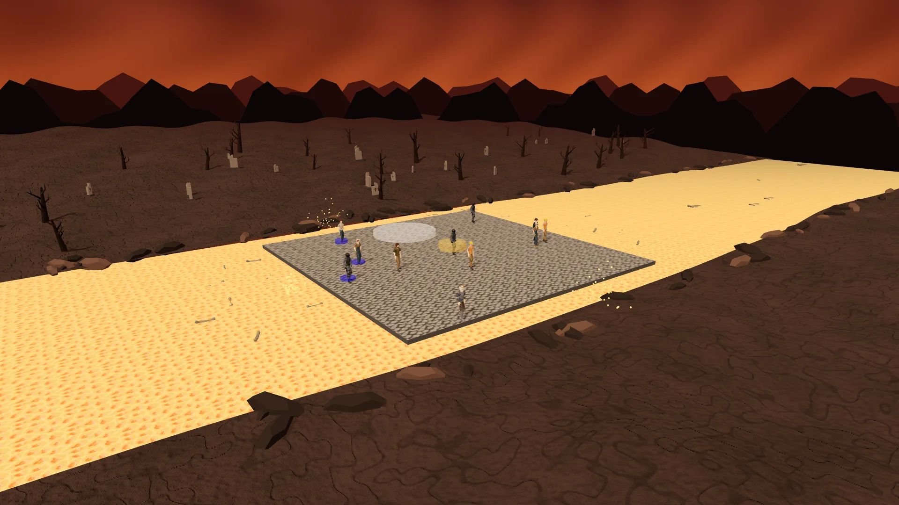
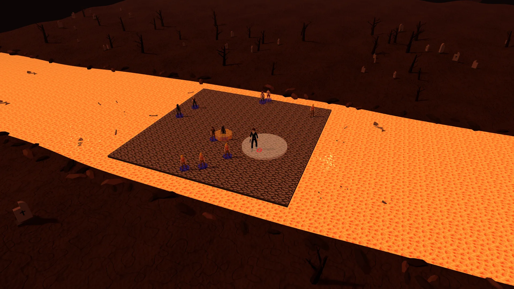
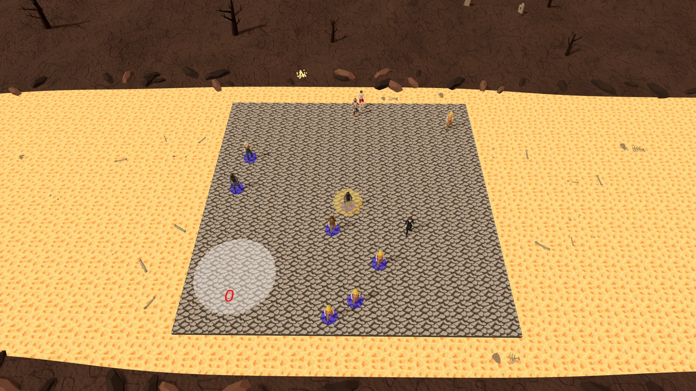
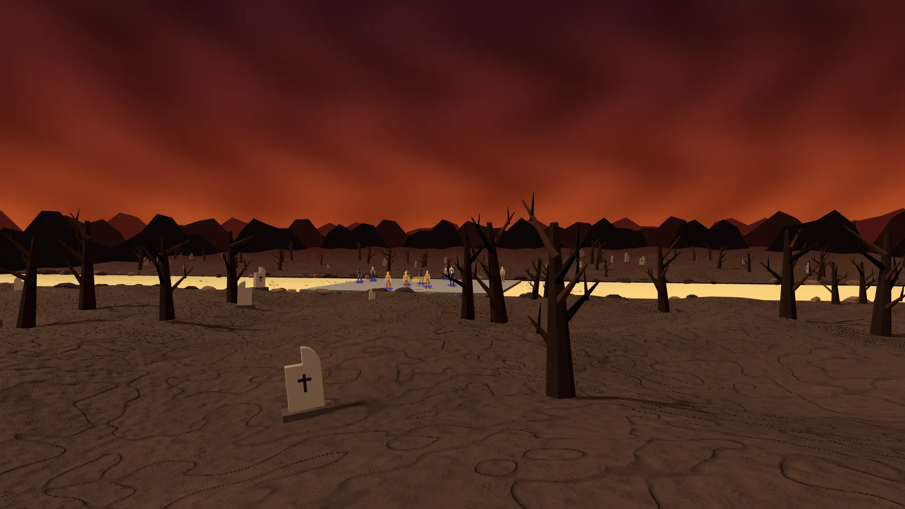

# Assassin

The sniper must figure out who the assassins are in the crowd of NPCs. Stop them with 3 bullets before they assassinate all the others!



## Getting Started

First you will need to setup a .env file from the .env.sample provided.

Then development server can be run:

```bash
pnpm run dev
```

## Scripts

In the scripts folder is reset_public and sync_to_s3. This is only for Articles Media usage. Allows for putting public folder to CloudFront to lower Vercel charges for the public facing site.

## Multiplayer

Two types of multiplayer, one is local play with up to four controllers, or via websockets with friends online!

## Inspiration

[Hidden in Plain Sight: Assassin](https://store.steampowered.com/app/303590/Hidden_in_Plain_Sight/)

## Previews





## Attributions

[Character Models - Quaternius](https://quaternius.com/packs/ultimatemodularcharacters.html)  
[Skull and Sword Models - Quaternius](https://quaternius.com)  
[Skull Candle Models - Kay Lousberg](https://poly.pizza/m/94tuTO5eJv)  
[Crosshair Icon - stockesdesign](https://www.magnific.com/icon/targets_5410994#fromView=search&page=1&position=0&uuid=bab299c9-14a2-42d6-bbbe-b0a5a62833c3)  
[Sword Font - Vladimir Nikolic](https://www.dafont.com/sword.font?text=%28Assassin%29)
